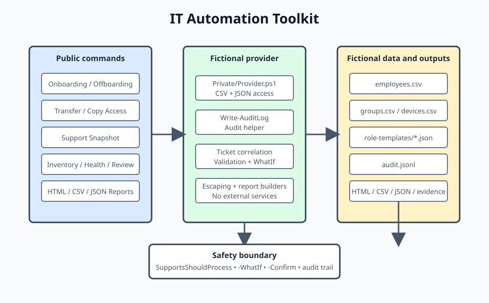

# PowerShell IT Automation Toolkit

[](https://github.com/YOUR_USERNAME/PowerShell-IT-Automation-Toolkit/actions/workflows/ci.yml)   

A fictional-data PowerShell module that demonstrates safe IT operations automation: onboarding and offboarding, access reviews, device health, password-policy metadata checks, report exports and JSON-lines audit trails.

## Why this matters for helpdesk and sysadmin work

IT support teams repeat the same account, access and device tasks every day. Manual work can be inconsistent and difficult to audit. This project demonstrates how those workflows can be structured as reusable commands with validation, explicit previews, error handling, audit records and automated tests. It is a portfolio simulation, not a production identity-management system.

## Features

- **Onboarding:** create a fictional employee record, assign department role-template groups and return a checklist.
- **Batch onboarding:** import multiple fictional hires from CSV, validate each row independently, and return a success/failure summary.
- **Employee transfers:** move a fictional employee to a valid department, reconcile old/new department groups, preserve common groups, update an optional manager, and flag owned devices for review.
- **Role templates:** use department JSON templates with CSV fallback for Engineering, Finance, Operations, Support and HumanResources onboarding or transfer access.
- **Access copying:** copy missing group memberships between fictional employees, preview additions and reject privileged groups unless explicitly included.
- **Offboarding lifecycle:** disable a simulated account, capture an evidence snapshot, schedule account expiry, configure manager mailbox forwarding in the simulation, remove groups and return a follow-up checklist.
- **Access reviews:** identify stale accounts, privileged group membership and missing manager or owner references.
- **Device inventory and health:** inspect OS metadata, last-seen dates, disk space, patch status and return flags.
- **Password policy metadata:** check password age, fictional password-length metadata, missing set dates, reset-required flags and never-expiring metadata. No passwords are read or stored; password length is represented by explicitly fictional metadata because directory systems generally do not reveal users’ actual passwords.
- **Support snapshots:** combine identity, group, device health, and access-review data for one employee as text or an object.
- **Ticket correlation:** state-changing commands and audit-writing commands accept optional `-TicketId` values and record/filter them.
- **HTML operations report:** create a single self-contained responsive report with summary cards, device/access/audit tables, filtering, sorting, and system dark/light mode.
- **Reports:** export objects as timestamped CSV and JSON (list properties such as `Flags` are joined with `;` in CSV).
- **Audit trail:** JSON Lines records include UTC timestamp, actor, action, target, result, ticket ID and dry-run status.
- **Safe operation:** state-changing commands support `-WhatIf` and `-Confirm`.
- **Cross-platform CI:** GitHub Actions runs PSScriptAnalyzer and Pester on Windows and Ubuntu.

## Quick start

Requirements: PowerShell 7+ recommended; Pester 5 and PSScriptAnalyzer for tests/linting. Windows PowerShell 5.1 compatibility is intended where practical but CI targets modern `pwsh`.

```powershell
Import-Module ./src/ITAutomationToolkit/ITAutomationToolkit.psd1 -Force
Get-DeviceInventory
Get-DeviceHealthReport | Format-Table DeviceName, IsHealthy, Flags
Get-UserAccessReview -StaleAfterDays 90 | Format-Table EmployeeId, StaleAccount, ExcessPrivileges, MissingManager, MissingOwner
```

### Dry-run onboarding

```powershell
New-EmployeeOnboarding `
  -EmployeeId EMP-110 `
  -DisplayName 'Demo User 110' `
  -Email 'demo.user110@example.invalid' `
  -Department Engineering `
  -ManagerId EMP-104 `
  -WhatIf
```

`-WhatIf` prints a preview and writes a `DryRun` entry to the audit trail without changing the CSV directory. After reviewing the plan, omit `-WhatIf` to apply changes to the local simulation. Use `-Confirm:$false` only when you're deliberately running unattended against the fictional data.

### Try changes without touching the sample data

Commands without `-WhatIf` edit the CSV files the module reads. To experiment safely, point the toolkit at a scratch copy:

```powershell
Copy-Item ./data $env:TEMP/itat-data -Recurse
$env:ITAT_DATA_PATH = "$env:TEMP/itat-data"
$env:ITAT_REPORTS_PATH = "$env:TEMP/itat-reports"
```

If you already changed the repo copy, restore it with `git restore data`. Remove the variables (or open a new session) to go back to the repo data.

### Example output (illustrative)

```text
DeviceName         IsHealthy Flags
----------         --------- -----
DEMO-LAPTOP-201         True {}
DEMO-LAPTOP-202        False {LowDiskSpace, PatchRequired}
DEMO-LAPTOP-203        False {DeviceStale}
```

Output depends on the current date because stale-device and stale-account flags use date thresholds.

### Helpdesk text snapshot

```powershell
Get-UserSupportSnapshot -EmployeeId EMP-101 -Format Text -TicketId HD-1234
```

```text
User Support Snapshot
Employee: Demo User 101 [EMP-101]
Email: demo.user101@example.invalid
Department: Engineering
Manager: Demo User 104 [EMP-104]
Account status: Enabled
Groups: Engineering-Standard, Source-Control
Devices: DEMO-LAPTOP-201 [DEV-201] flags=
Last sign-in: 2026-10-20
Access flags: None
Ticket: HD-1234
```

## Example commands

```powershell
# Build a ticket-ready support snapshot and filter audit records
Get-UserSupportSnapshot -EmployeeId EMP-101 -Format Text -TicketId HD-1234
Get-AuditLog -TicketId HD-1234

# Create a self-contained HTML operations report
New-ToolkitHtmlReport -Name support-operations -TicketId HD-1234

# Preview and apply a fictional employee transfer
Invoke-EmployeeTransfer -EmployeeId EMP-101 -NewDepartment Finance -NewManagerId EMP-104 -WhatIf
Invoke-EmployeeTransfer -EmployeeId EMP-101 -NewDepartment Finance -NewManagerId EMP-104 -Confirm:$false

# Preview or run bulk onboarding from CSV
Import-EmployeeBatch -CsvPath ./data/sample-new-hires.csv -WhatIf
Import-EmployeeBatch -CsvPath ./data/sample-new-hires.csv -Confirm:$false

# Preview copied access; privileged groups require explicit opt-in
Copy-UserAccess -SourceEmployeeId EMP-101 -TargetEmployeeId EMP-102 -WhatIf
Copy-UserAccess -SourceEmployeeId EMP-101 -TargetEmployeeId EMP-102 -IncludePrivileged -Confirm:$false

# Preview then simulate a leaver workflow
Invoke-EmployeeOffboarding -EmployeeId EMP-103 -WhatIf
Invoke-EmployeeOffboarding -EmployeeId EMP-103 -Confirm:$false

# Review password metadata only; never inspect actual passwords
Test-PasswordPolicyCompliance | Format-Table EmployeeId, Compliant, Flags

# Export health report as CSV and JSON
Get-DeviceHealthReport | Export-ToolkitReport -Name device-health -Format Both -Confirm:$false

# Read the audit trail
Get-Content ./reports/audit.jsonl | ForEach-Object { $_ | ConvertFrom-Json }
```

## Screenshots and sample output

Place screenshots under [`docs/screenshots/`](docs/screenshots/) before publishing:

1. `operations-report.png` — the self-contained HTML operations report.
2. `support-snapshot.png` — the text snapshot pasted into a helpdesk ticket.

Do not include real personal data, secrets, tenant identifiers or credentials in screenshots. Sample output above is illustrative; generate captures only from the fictional local simulation.

## Architecture



## Folder structure

```text
.
├── .github/workflows/ci.yml
├── data/                         # Fictional CSV/JSON source data
├── docs/
│   ├── RUNBOOK.md
│   ├── TROUBLESHOOTING.md
│   ├── architecture.svg
│   └── screenshots/
├── reports/                      # Generated files; gitignored
├── src/ITAutomationToolkit/
│   ├── Private/                  # CSV/JSON provider and audit writer
│   ├── Public/                   # Exported advanced functions
│   ├── ITAutomationToolkit.psd1
│   └── ITAutomationToolkit.psm1
├── tests/                        # Pester v5 tests
├── PSScriptAnalyzerSettings.psd1
├── SECURITY.md
├── .editorconfig
├── CONTRIBUTING.md
├── CHANGELOG.md
└── LICENSE
```

## Scope and honesty

This is a portfolio simulation. It uses fictional people, reserved example email addresses, CSV/JSON provider data, and no live directory or cloud tenant. It has not been run against a live Active Directory domain or Microsoft 365 tenant.

The current implementation intentionally models provider operations rather than connecting to production systems. Real providers could replace `src/ITAutomationToolkit/Private/Provider.ps1` with authenticated Active Directory, Microsoft Graph, Exchange, licence and device APIs while preserving the public command contracts. Such a replacement would require separate credential, authorization, tenant, approval, auditing and rollback controls.

## Inspiration

The following projects were sources of ideas for helpdesk automation concepts and terminology only. This repository does not reuse their code:

- Microsoft-365-HelpDesk-Automation
- onboarding-automation
- active-directory-automation
- PowerShell-Onboarding-Automation-Suite

## Design decisions

- **Fictional data only:** names use `Demo User NNN`; addresses use the reserved `.invalid` domain. No real credentials, tenants or endpoints are required.
- **Provider boundary:** private CSV/JSON provider functions isolate data access. A future Active Directory or Microsoft Graph provider could implement the same operations without changing every public command.
- **No real password generation:** onboarding returns a clearly labelled non-secret reset placeholder and checklist. A production identity system should generate and deliver credentials through approved secure workflows.
- **Auditing:** JSONL is human-readable and easy to ingest into log tooling. This demo does not provide tamper-evident or centralized logging.
- **Safety:** mutating commands use `SupportsShouldProcess`. Preview intent is recorded as `DryRun`; reports and audit files are generated locally.
- **Cross-platform scope:** CI targets Windows and Ubuntu. OS-specific real administration actions are intentionally outside the current scope.

## Tests and linting

Install dependencies once:

```powershell
Install-Module Pester -MinimumVersion 5.0.0 -MaximumVersion 5.99.99 -Scope CurrentUser -SkipPublisherCheck
Install-Module PSScriptAnalyzer -Scope CurrentUser -Force
```

Run Pester:

```powershell
Invoke-Pester ./tests
```

Run PSScriptAnalyzer:

```powershell
Invoke-ScriptAnalyzer -Path ./src/ITAutomationToolkit -Recurse -Settings ./PSScriptAnalyzerSettings.psd1
```

CI runs both on `windows-latest` and `ubuntu-latest` and uploads Pester results and sample reports as artifacts. Run the commands locally before relying on the project; CI status is authoritative after the repository is pushed.

## Roadmap

- Add a real Active Directory provider behind the existing provider interface, with explicit opt-in and integration tests.
- Add a Microsoft Graph/Intune provider for device compliance and identity metadata.
- Add stronger schema validation and rollback behavior for multi-file simulated changes.
- Add signed module releases and versioned changelog automation.
- Add report retention controls and tamper-evident audit export.

## Why I built this

I built this portfolio project to practise translating routine IT support and systems administration tasks into repeatable, testable automation. The focus is on safety, clear operator feedback, auditability and documentation rather than connecting to a live company environment.

## License

MIT. See [LICENSE](LICENSE).
